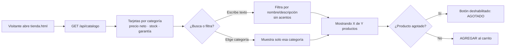

# Análisis del módulo «Catálogo y Búsqueda de Productos»

**Proyecto:** FluxGuard — Comercio electrónico de monitoreo eléctrico IoT
**Materia:** Negocios Electrónicos I · Tema 3. Gestión y seguridad de datos
**Criterios de la guía que cubre:** 02 (análisis del módulo) y 06 (precios netos, stock y garantías visibles)

---

## 1. Objetivo del módulo

Permitir que cualquier visitante, con o sin cuenta, conozca los productos y servicios de FluxGuard y los encuentre rápidamente. Cada producto muestra su **precio neto con IVA incluido**, la **disponibilidad en stock** y la **garantía**, para que el cliente decida su compra con información clara antes de agregarla al carrito.

## 2. Actores

| Actor | Qué hace en el módulo |
|---|---|
| Visitante (sin sesión) | Consulta el catálogo, busca, filtra y agrega productos al carrito como invitado. |
| Cliente (con sesión) | Lo mismo que el visitante; además puede agregar planes de monitoreo, que se activan en su cuenta. |
| Administrador | Mantiene precios, stock y garantías en el catálogo (`CatalogoService.java`). |

## 3. Requisitos funcionales

| ID | Requisito | Dónde se implementa |
|---|---|---|
| RF-C1 | Mostrar el catálogo agrupado por categoría: Hardware (Kit Piloto), Accesorios (personalización), Garantías (servicios) y Planes. | `tienda.html`, `GET /api/catalogo` |
| RF-C2 | Buscar productos por **nombre o descripción**, sin distinguir mayúsculas ni acentos («bateria» encuentra «Batería»). | `tienda.html` → `initBusqueda()` |
| RF-C3 | Filtrar por categoría con botones: Todos, Hardware, Accesorios, Garantías y Planes. La búsqueda y el filtro se combinan. | `tienda.html` → `.shop-filter` |
| RF-C4 | Mostrar el contador «Mostrando X de Y productos» y un mensaje cuando no hay coincidencias. | `tienda.html` |
| RF-C5 | Mostrar en cada producto el **precio neto** y la etiqueta «Precios netos · IVA incluido». | `tienda.html`, `styles.css` |
| RF-C6 | Mostrar la **disponibilidad**: «En stock · N unidades», «Últimas piezas» (5 o menos) o «Agotado». Un producto agotado no se puede agregar. | `tienda.html` → `disponibilidad()`; validado en `CarritoService` |
| RF-C7 | Mostrar la **garantía** de cada producto (p. ej. «Garantía de 1 año incluida»). | `Producto.garantia`, `tienda.html` |
| RF-C8 | Mostrar opiniones positivas de clientes (carrusel de reseñas) a los visitantes sin sesión. | `tienda.html`, `GET /api/resenas/destacadas` |

## 4. Requisitos no funcionales

- **Usabilidad:** la búsqueda filtra mientras se escribe, sin recargar la página; diseño adaptable a celular.
- **Consistencia de precios:** el precio que ve el cliente sale del servidor. El navegador nunca envía precios, así que no se pueden alterar desde la página.
- **Accesibilidad:** filtros con `aria-pressed`, contador con `aria-live` y etiquetas en el campo de búsqueda.

## 5. Datos del módulo

El catálogo es una lista fija en el servidor (`CatalogoService.java`) y no se guarda en MongoDB: así un precio no puede cambiarse desde la base de datos ni desde el navegador.

**Estructura de un producto** (`model/Producto.java`):

| Campo | Tipo | Descripción |
|---|---|---|
| `id` | texto | Identificador (`kit-piloto`, `pantalla-oled`, …) |
| `nombre`, `descripcion` | texto | Lo que se muestra y en lo que se busca |
| `categoria` | enum | `PROTOTIPO`, `PERSONALIZACION`, `SERVICIO`, `PLAN` |
| `precio` | entero (MXN) | Precio neto con IVA incluido |
| `unidad` | texto | «PAGO ÚNICO», «POR KIT», «MXN / MES» |
| `requiereKit` | booleano | Accesorios y garantía solo se venden junto con un Kit Piloto |
| `maxCantidad` | entero | Límite por pedido (1 para planes) |
| `stock` | entero o nulo | Unidades disponibles; nulo = no aplica (servicios y planes) |
| `garantia` | texto o nulo | Texto de garantía que se muestra al cliente |

**Catálogo actual:**

| Producto | Categoría | Precio neto | Stock | Garantía |
|---|---|---|---|---|
| Kit Piloto FluxGuard | Hardware | $350 pago único | 24 | 1 año incluida |
| Carcasa personalizada | Accesorio | $180 por kit | 30 | 6 meses incluida |
| Pantalla OLED integrada | Accesorio | $150 por kit | 12 | 1 año incluida |
| Batería de respaldo | Accesorio | $200 por kit | 5 | 6 meses incluida |
| Garantía extendida 12 meses | Garantía | $250 por kit | — | Extiende la del kit a 2 años |
| Plan Free | Plan | $0 | — | — |
| Plan Standard | Plan | $499 / mes | — | — |

## 6. API

| Método | Ruta | Respuesta |
|---|---|---|
| GET | `/api/catalogo` | Lista de productos con precio, stock y garantía. Es pública. |
| GET | `/api/resenas/destacadas` | Reseñas de 4 y 5 estrellas con comentario, para el carrusel. Es pública. |

## 7. Flujo

## 8. Reglas de negocio

1. Los precios siempre incluyen IVA (precio neto); el ticket desglosa el IVA del 16 %.
2. Si quedan 5 piezas o menos se muestra «Últimas piezas»; con 0 se muestra «Agotado» y no se puede agregar.
3. El servidor vuelve a validar el stock al agregar al carrito: aunque alguien manipule la página, no puede pedir más unidades de las disponibles.
4. Los accesorios y la garantía extendida requieren un Kit Piloto en el carrito o comprado antes.

## 9. Mejoras identificadas

- El stock está definido en el catálogo y **no se descuenta automáticamente** con cada venta. Para un inventario real habría que guardarlo en MongoDB y restarlo al confirmar el pago.
- Agregar orden por precio y paginación cuando el catálogo crezca.
