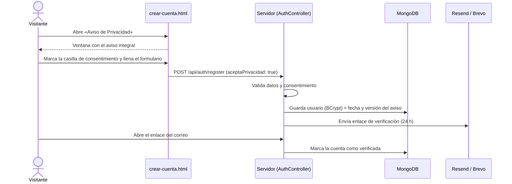

# Análisis del módulo «Gestión de Cuenta de Usuario»

**Proyecto:** FluxGuard — Comercio electrónico de monitoreo eléctrico IoT
**Materia:** Negocios Electrónicos I · Tema 3. Gestión y seguridad de datos
**Criterios de la guía que cubre:** 03 (análisis del módulo) y 07 (aviso de privacidad integral, consentimiento expreso y acceso al historial)

---

## 1. Objetivo del módulo

Que el cliente cree y administre su cuenta de forma segura, con su **consentimiento expreso** para el tratamiento de sus datos personales, y que pueda consultar su **historial de compras** en cualquier momento.

## 2. Actores

| Actor | Qué hace en el módulo |
|---|---|
| Visitante | Lee el Aviso de Privacidad, acepta el consentimiento y crea su cuenta. |
| Cliente | Verifica su correo, inicia y cierra sesión, consulta «Mis compras», descarga sus tickets y opina sobre lo que compró. |
| Sistema de correo (Resend / Brevo) | Envía el enlace de verificación. |

## 3. Requisitos funcionales

| ID | Requisito | Dónde se implementa |
|---|---|---|
| RF-U1 | Registro con nombre, apellido, correo y contraseña (mínimo 8 caracteres, una mayúscula y un carácter especial). | `crear-cuenta.html`, `POST /api/auth/register` |
| RF-U2 | **Aviso de Privacidad Integral** visible y enlazado desde el registro; se abre en una ventana sobrepuesta. | `crear-cuenta.html`, `main.js` → `abrirAvisoPrivacidad()` |
| RF-U3 | **Consentimiento expreso (opt-in):** casilla obligatoria «He leído y acepto el Aviso de Privacidad y autorizo el tratamiento de mis datos personales». No viene marcada. | `crear-cuenta.html`; validado en `AuthController` |
| RF-U4 | Guardar **cuándo** se aceptó el aviso y **qué versión**, como evidencia del consentimiento. | `Usuario.privacidadAceptadaEn`, `Usuario.versionAvisoPrivacidad` |
| RF-U5 | Verificación del correo con un enlace que vence en 24 horas; se puede pedir otro enlace cada 60 segundos. | `GET /api/auth/verify`, `POST /api/auth/resend` |
| RF-U6 | Inicio de sesión con una sesión de 7 días y cierre de sesión. | `POST /api/auth/login`, `POST /api/auth/logout` |
| RF-U7 | **Historial de compras** con folio, fecha, productos, método de pago, estado y total. | «Mis compras» (menú de usuario y dashboard), `GET /api/pedidos` |
| RF-U8 | Desde el historial: descargar el ticket en PDF, imprimirlo y opinar sobre lo comprado. | `main.js` → `abrirHistorialCompras()` |

## 4. Aviso de Privacidad Integral

Elementos que incluye (`main.js` → `AVISO_PRIVACIDAD_HTML`):

1. Identidad y domicilio del responsable.
2. Datos personales que se recaban (identificación, cuenta, compras y reseñas); se aclara que **no se guardan datos de tarjetas** ni datos sensibles.
3. Finalidades primarias y secundarias, con la forma de negarse a las secundarias.
4. Con quién se comparten los datos (hosting, correo, procesadores de pago, paquetería) y que **no se venden**.
5. Derechos ARCO (Acceso, Rectificación, Cancelación y Oposición) y cómo ejercerlos.
6. Revocación del consentimiento y limitación del uso.
7. Uso del almacenamiento del navegador (sesión y carrito de invitado; sin cookies de publicidad).
8. Cambios al aviso y fecha de actualización.
9. Autoridad competente.

Cada vez que cambia el texto del aviso se actualiza `AuthController.VERSION_AVISO_PRIVACIDAD`, para saber qué versión aceptó cada usuario.

## 5. Datos del módulo (colección `usuarios` en MongoDB)

| Campo | Descripción |
|---|---|
| `nombre`, `apellido` | Datos de identificación |
| `correo` | Único (índice único); se guarda en minúsculas |
| `passwordHash` | Contraseña cifrada con **BCrypt**; nunca se guarda en texto plano |
| `verificado` | Si confirmó su correo |
| `tokenVerificacionHash`, `tokenExpira`, `tokenEnviadoEn` | Enlace de verificación: solo se guarda el **hash SHA-256** del token |
| `privacidadAceptadaEn`, `versionAvisoPrivacidad` | Evidencia del consentimiento expreso |
| `suscripcion` | Plan de monitoreo activo (plan, circuitos, fecha de renovación, folio) |
| `fechaRegistro` | Fecha de alta |

**Colección `sesiones`:** guarda el hash del token de sesión, el usuario y la fecha de expiración. MongoDB borra la sesión automáticamente al vencer (índice TTL).

## 6. API

| Método | Ruta | Descripción |
|---|---|---|
| POST | `/api/auth/register` | Crea la cuenta. Sin `aceptaPrivacidad: true` responde **400**. |
| GET | `/api/auth/verify?token=` | Activa la cuenta desde el correo. |
| POST | `/api/auth/resend` | Reenvía el enlace de verificación. |
| POST | `/api/auth/login` | Devuelve el usuario y el token de sesión. |
| GET | `/api/auth/me` | Usuario de la sesión actual. |
| POST | `/api/auth/logout` | Cierra la sesión. |
| GET | `/api/pedidos` | Historial de compras del usuario (requiere sesión; solo sus pedidos). |
| GET | `/api/pedidos/{folio}/ticket` | Ticket en PDF de un pedido pagado del usuario. |

## 7. Flujo de registro con consentimiento

## 8. Reglas de negocio y seguridad

1. Sin la casilla marcada no se crea la cuenta: lo valida la página **y también el servidor**.
2. Un correo solo puede tener una cuenta.
3. No se puede iniciar sesión sin verificar el correo.
4. El inicio de sesión responde lo mismo si el correo no existe o si la contraseña es incorrecta, para que nadie pueda averiguar qué correos están registrados.
5. Las páginas protegidas (dashboard, historial) validan la sesión con el servidor, no solo en el navegador.
6. Cada usuario solo ve sus propios pedidos y tickets.

## 9. Mejoras identificadas

- Los usuarios que se registraron antes de agregar el consentimiento no tienen la aceptación guardada; se les puede pedir al iniciar sesión.
- Agregar en «Mi cuenta» opciones para editar datos y solicitar la cancelación (derechos ARCO) sin escribir un correo.
