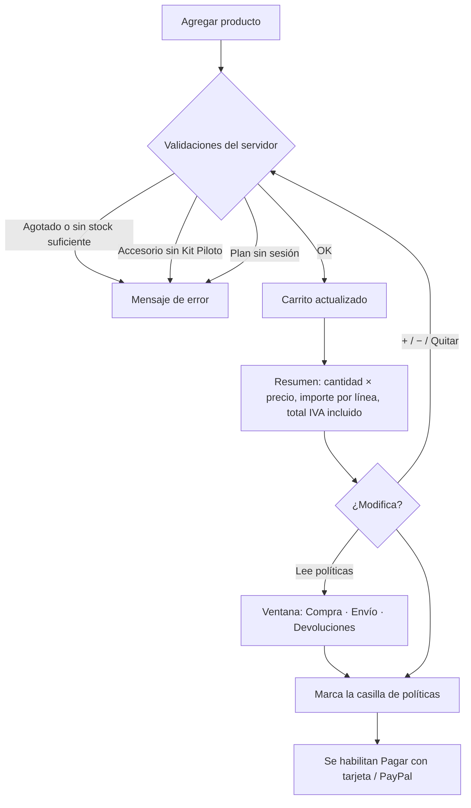

# Análisis del módulo «Carrito de Compras»

**Proyecto:** FluxGuard — Comercio electrónico de monitoreo eléctrico IoT
**Materia:** Negocios Electrónicos I · Tema 3. Gestión y seguridad de datos
**Criterios de la guía que cubre:** 04 (análisis del módulo) y 08 (resumen desglosado, modificación dinámica y acceso a políticas)

---

## 1. Objetivo del módulo

Reunir los productos que el cliente quiere comprar, permitirle **modificarlos al momento**, mostrarle un **resumen claro** de lo que pagará y darle acceso a las **políticas de compra, envío y devoluciones** antes de pagar.

## 2. Actores

| Actor | Qué hace en el módulo |
|---|---|
| Visitante (invitado) | Agrega hardware y servicios; su carrito se identifica con un token propio del navegador. |
| Cliente (con sesión) | Igual que el invitado, y además puede agregar un plan de monitoreo. Al iniciar sesión, lo que agregó como invitado pasa a su cuenta. |

## 3. Requisitos funcionales

| ID | Requisito | Dónde se implementa |
|---|---|---|
| RF-K1 | Agregar productos desde la tienda, con cantidad. | `tienda.html` → `agregarAlCarrito()`, `POST /api/carrito/items` |
| RF-K2 | **Modificación dinámica:** botones + / − y «Quitar» que actualizan el carrito sin recargar la página. | `main.js` → `conectarLineasCarrito()`, `PUT` / `DELETE /api/carrito/items/{id}` |
| RF-K3 | **Resumen desglosado por producto:** nombre, cantidad × precio unitario, importe de cada línea y total con IVA incluido. | `carrito.html` → `renderResumen()`, panel lateral |
| RF-K4 | Contador de artículos en el ícono del carrito, visible en todas las páginas. | `main.js` → `actualizarContadorCarrito()` |
| RF-K5 | **Acceso a políticas:** tarjetas «Políticas de compra», «Envío» y «Devoluciones y garantía» que abren cada política en una ventana sobrepuesta. | `carrito.html`, `main.js` → `abrirPoliticas()` |
| RF-K6 | Casilla obligatoria «He leído y acepto las políticas de compra, envío y devoluciones»; sin marcarla, los botones de pago están deshabilitados. | `carrito.html` → `actualizarBotonesPago()` |
| RF-K7 | Avisos automáticos cuando el carrito se ajusta (por ejemplo, si se quitan kits y sobran accesorios). | `CarritoService.normalizar()` |
| RF-K8 | Carrito de invitado que se fusiona con el de la cuenta al iniciar sesión. | `POST /api/carrito/fusionar` |

## 4. Políticas disponibles desde el carrito

| Política | Contenido principal |
|---|---|
| Compra | Precios en MXN con IVA, métodos de pago (tarjeta con Stripe, PayPal), folio de compra, factura, reglas del carrito, stock. |
| Envío | Qué se envía (solo hardware), cobertura nacional, costo incluido en el precio, tiempos de preparación y entrega, revisión del paquete. |
| Devoluciones y garantía | Cancelación en 5 días hábiles (Ley Federal de Protección al Consumidor), garantía por producto, proceso de devolución, planes. |

## 5. Datos del módulo (colección `carritos` en MongoDB)

| Campo | Descripción |
|---|---|
| `usuarioId` | Dueño del carrito: id del usuario o `invitado:<hash>` (índice único) |
| `items[]` | Lista de `{ productoId, cantidad }` |
| `actualizado` | Última modificación |

El carrito **solo guarda productos y cantidades, nunca precios**: el resumen se calcula siempre con los precios del catálogo del servidor.

## 6. API

| Método | Ruta | Descripción |
|---|---|---|
| GET | `/api/carrito` | Carrito actual con líneas, importes, total y avisos |
| POST | `/api/carrito/items` | Agrega un producto (`productoId`, `cantidad`) |
| PUT | `/api/carrito/items/{productoId}` | Cambia la cantidad (0 = quitar) |
| DELETE | `/api/carrito/items/{productoId}` | Quita el producto |
| POST | `/api/carrito/fusionar` | Pasa el carrito de invitado a la cuenta |

Con sesión se identifica con `Authorization: Bearer <token>`; como invitado, con el encabezado `X-Carrito-Invitado`.

## 7. Flujo

## 8. Reglas de negocio

1. Solo un plan a la vez; agregar otro reemplaza al anterior y siempre con cantidad 1.
2. Personalizaciones y garantía extendida: máximo una de cada una por Kit Piloto (en el carrito o comprado y pagado antes).
3. No se puede pedir más que el stock disponible ni más de 10 piezas de un producto por pedido.
4. Los invitados pueden comprar hardware y servicios, pero no planes (se activan en una cuenta).
5. Si se reduce el número de kits, los accesorios se ajustan solos y se avisa al cliente.

## 9. Mejoras identificadas

- **Desglose de impuestos en el carrito:** hoy el resumen muestra el importe de cada línea y el total con IVA incluido; el desglose de **subtotal e IVA (16 %)** aparece en el ticket de compra. Se recomienda mostrar también *Subtotal · IVA · Envío (incluido) · Total* en el resumen del carrito.
- Guardar en el pedido la aceptación de políticas (fecha y versión), igual que se hace con el aviso de privacidad.
