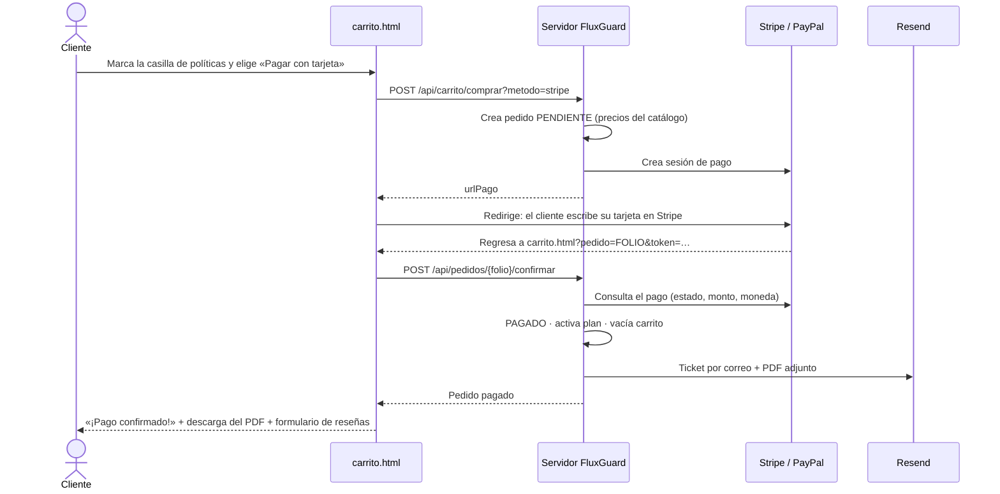
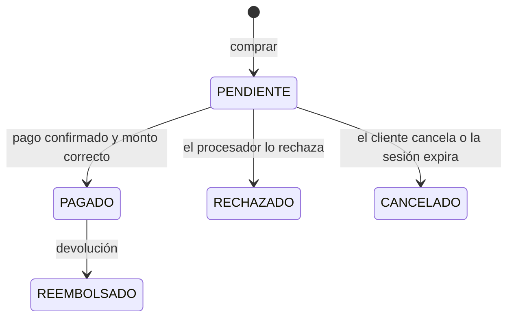

# Análisis del módulo «Proceso de Pago (Checkout)»

**Proyecto:** FluxGuard — Comercio electrónico de monitoreo eléctrico IoT
**Materia:** Negocios Electrónicos I · Tema 3. Gestión y seguridad de datos
**Criterios de la guía que cubre:** 05 (análisis del módulo), 09 (cifrado de datos, integración segura PCI-DSS y confirmación inmediata) y 10 (reseñas al terminar la compra)

---

## 1. Objetivo del módulo

Cobrar el pedido de forma **segura**, sin que FluxGuard reciba ni guarde datos de tarjetas. Al confirmarse el pago, el cliente recibe **confirmación inmediata** (pantalla, correo y ticket en PDF) y puede **opinar** sobre lo que compró.

## 2. Actores

| Actor | Qué hace en el módulo |
|---|---|
| Cliente o invitado | Elige el método de pago, paga en la página del procesador y regresa a FluxGuard. |
| Stripe | Procesa el pago con tarjeta en su propia página (Stripe Checkout). |
| PayPal | Procesa el pago con cuenta PayPal (PayPal Checkout, API v2). |
| Resend / Brevo | Envían el ticket de compra por correo con el PDF adjunto. |

## 3. Requisitos funcionales

| ID | Requisito | Dónde se implementa |
|---|---|---|
| RF-P1 | Mostrar solo los métodos de pago configurados en el servidor (tarjeta, PayPal). | `GET /api/pagos/metodos` |
| RF-P2 | Crear el pedido como **PENDIENTE** con los precios del catálogo y redirigir a Stripe o PayPal. | `POST /api/carrito/comprar?metodo=` |
| RF-P3 | Al regresar, **verificar el pago con el procesador** y que el **monto y la moneda coincidan** con el pedido antes de marcarlo como PAGADO. | `POST /api/pedidos/{folio}/confirmar`, `PagoService` |
| RF-P4 | Confirmar el pago aunque el cliente cierre la ventana (webhook de Stripe firmado). | `POST /api/pagos/stripe/webhook` |
| RF-P5 | **Confirmación inmediata en pantalla:** «¡Pago confirmado!» con folio, total, método y productos. | `carrito.html` → `mostrarExito()` |
| RF-P6 | **Ticket por correo** con el PDF adjunto, enviado una sola vez al confirmarse el pago. | `CorreoService.enviarTicket()`, `TicketPdf` |
| RF-P7 | El **ticket en PDF se descarga automáticamente** al confirmarse la compra; también se puede volver a descargar o imprimir. | `descargarTicketPdf()`, `GET /api/pedidos/{folio}/ticket` |
| RF-P8 | Activar el plan de monitoreo comprado y vaciar el carrito. | `PagoService.completar()` |
| RF-P9 | **Reseñas post-compra:** al terminar la compra, el cliente califica cada producto con estrellas (1 a 5) y un comentario. Sin sesión se muestra un carrusel de reseñas positivas. | `carrito.html`, `POST /api/resenas` |
| RF-P10 | Cancelar el pago sin perder el carrito. | `POST /api/pedidos/{folio}/cancelar` |

## 4. Seguridad del pago

### 4.1 Integración segura (PCI-DSS)

- FluxGuard **no captura, no transmite y no almacena datos de tarjetas**. El cliente los escribe en la página de **Stripe Checkout** o de **PayPal**, que son proveedores certificados PCI-DSS nivel 1.
- El servidor solo recibe una referencia del pago (id de la sesión de Stripe o de la orden de PayPal) y la consulta directamente al procesador con su llave secreta.
- Con este esquema (páginas de pago alojadas por el procesador), el sitio queda en el alcance mínimo de PCI-DSS.

### 4.2 Cifrado de datos

| Dato | Protección |
|---|---|
| Comunicación navegador ↔ servidor ↔ procesadores | HTTPS / TLS (Render y las APIs de Stripe, PayPal y Resend) |
| Contraseñas | Hash **BCrypt** |
| Tokens de sesión y de verificación | Solo se guarda su hash **SHA-256** |
| Llaves de Stripe, PayPal, Resend, MongoDB | Variables de entorno (`.env` local o panel de Render); nunca en el repositorio |
| Webhook de Stripe | Firma HMAC verificada con `STRIPE_WEBHOOK_SECRET` |

### 4.3 Controles contra fraude o errores

1. El precio se toma del catálogo del servidor, nunca del navegador.
2. Antes de marcar un pedido como PAGADO se comprueba que el **monto cobrado y la moneda** coinciden con el pedido.
3. La referencia de pago debe pertenecer a ese pedido (no se puede reutilizar el pago de otro).
4. La confirmación es **idempotente**: recargar la página o recibir el webhook dos veces no cobra, no activa ni envía el ticket dos veces.
5. Solo el dueño del pedido puede consultarlo o descargar su ticket.
6. Si el envío del correo falla, el pago sigue confirmado y el error queda registrado.

## 5. Datos del módulo (colección `pedidos` en MongoDB)

| Campo | Descripción |
|---|---|
| `folio` | Identificador para el cliente (`FLX-P12345678`), único |
| `usuarioId` | Dueño (usuario o `invitado:<hash>`) |
| `lineas[]` | Producto, nombre, precio unitario, cantidad e importe **al momento de comprar** |
| `total` | Total en MXN con IVA |
| `estado` | `PENDIENTE`, `PAGADO`, `RECHAZADO`, `CANCELADO`, `REEMBOLSADO` |
| `metodoPago` | `stripe`, `stripe_test`, `paypal`, `paypal_sandbox`, `sin_costo` |
| `ordenId`, `pagoId` | Referencias del procesador (no son datos de tarjeta) |
| `nombreCliente`, `correoCliente` | Para el ticket y el envío |
| `fecha`, `pagadoEn` | Fechas en hora del centro de México |

**Colección `resenas`:** usuario, producto, folio, autor publicado («Ana L.»), calificación (1–5), comentario y fecha. Índice único por usuario y producto.

## 6. Flujo de pago

## 7. Estados del pedido

## 8. Ticket de compra

Contiene folio, fecha, cliente, método de pago, referencia, productos (cantidad × precio e importe), **subtotal, IVA (16 %) y total**, más la aclaración de que no es un comprobante fiscal (CFDI). Se entrega de tres formas: correo con el PDF adjunto, descarga automática del PDF y versión imprimible de 80 mm.

## 9. Modo de prueba

Stripe funciona con llaves `sk_test_…` (tarjeta de prueba `4242 4242 4242 4242`) y PayPal en modo `sandbox`, por lo que **no se cobra dinero real** durante la evaluación.

## 10. Mejoras identificadas

- Integrar Paynet u OXXO para pagos en efectivo.
- Registrar reembolsos desde un panel de administración (hoy el estado `REEMBOLSADO` existe, pero se cambia manualmente).
