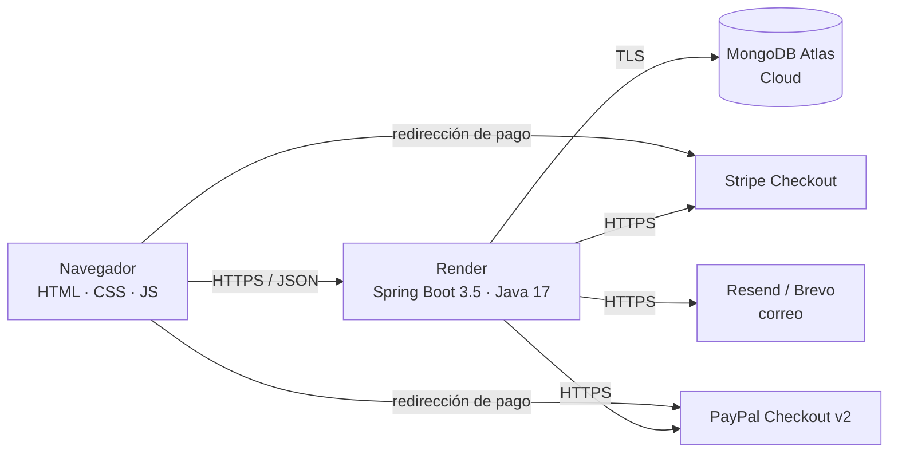
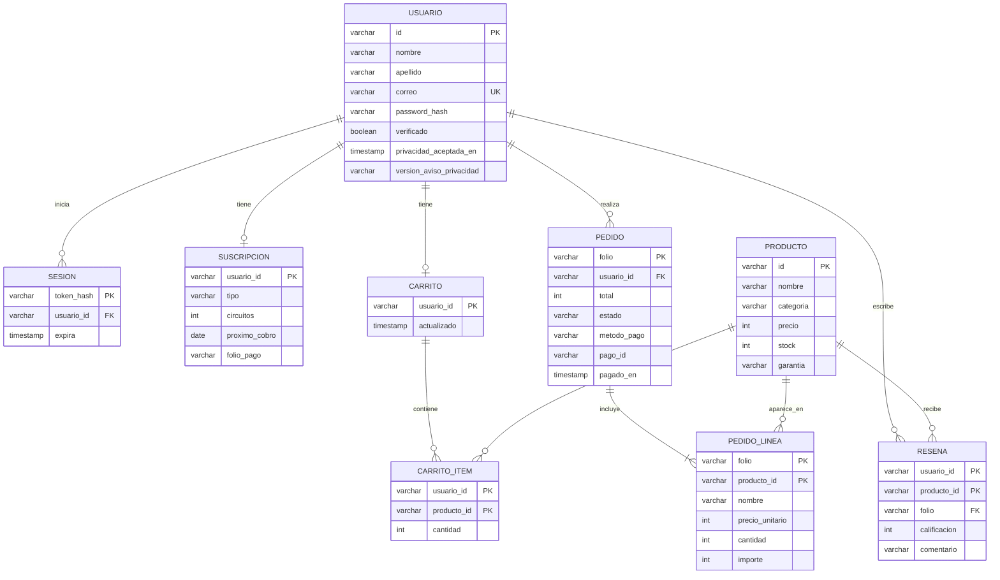

# Gestión y seguridad de datos

**Proyecto:** FluxGuard — Comercio electrónico de monitoreo eléctrico IoT
**Materia:** Negocios Electrónicos I · Tema 3. Gestión y seguridad de datos
**Competencia:** Diseña esquemas de modelo de datos SQL y NoSQL implementando medidas de seguridad en entornos Cloud.
**Criterios de la guía que cubre:** 09 (cifrado e integración segura), 11 (integración frontend–backend–APIs) y 16 (métodos seguros para la gestión de datos)

---

## 1. Arquitectura



- **Frontend:** páginas estáticas en `src/main/resources/static` (Bootstrap 5, JavaScript sin framework).
- **Backend:** API REST en Spring Boot, desplegada con Docker en Render.
- **Base de datos:** MongoDB Atlas (NoSQL, en la nube).
- **Servicios externos:** Stripe y PayPal (pagos), Resend y Brevo (correo).

## 2. Modelo de datos NoSQL (MongoDB)

| Colección | Documento | Índices |
|---|---|---|
| `usuarios` | Cuenta del cliente, con su suscripción embebida | `correo` único |
| `sesiones` | Sesiones iniciadas (hash del token) | `tokenHash` único; `expira` con **TTL** (MongoDB las borra al vencer) |
| `carritos` | Productos y cantidades del carrito | `usuarioId` único |
| `pedidos` | Compras con sus líneas embebidas | `folio` único; `usuarioId` |
| `resenas` | Opiniones post-compra | `(usuarioId, productoId)` único; `fecha` |
| `prospectos` | Solicitudes del formulario de contacto | `folio` |

**Decisiones de diseño NoSQL:**

- **Documentos embebidos** cuando los datos se leen juntos y pertenecen a un solo dueño: las líneas del pedido viven dentro del pedido y la suscripción dentro del usuario. Así una sola lectura trae todo y el pedido conserva el nombre y precio **tal como estaban al comprar**.
- **Referencias por id** entre colecciones independientes (`usuarioId` en carritos, pedidos y reseñas).
- El **catálogo** no está en la base de datos: vive en el servidor para que los precios no puedan alterarse.

Ejemplo de documento de `pedidos`:

```json
{
  "folio": "FLX-P48213377",
  "usuarioId": "6718f0c2a1b2c3d4e5f60789",
  "lineas": [
    { "productoId": "kit-piloto", "nombre": "Kit Piloto FluxGuard", "precioUnitario": 350, "cantidad": 2, "importe": 700 },
    { "productoId": "pantalla-oled", "nombre": "Pantalla OLED integrada", "precioUnitario": 150, "cantidad": 1, "importe": 150 }
  ],
  "total": 850,
  "estado": "PAGADO",
  "metodoPago": "stripe_test",
  "pagoId": "pi_…",
  "fecha": "2026-10-27T18:05:00",
  "pagadoEn": "2026-10-27T18:06:12"
}
```

## 3. Modelo equivalente en SQL (relacional)

El mismo dominio en un esquema relacional quedaría así: lo que en MongoDB está embebido se convierte en tablas con llave foránea.



**Comparación:** en SQL, un pedido requiere unir `PEDIDO` con `PEDIDO_LINEA`; en MongoDB se lee un solo documento. SQL da integridad referencial con llaves foráneas; en MongoDB esas reglas se validan en el servicio (por ejemplo, `ResenaService` comprueba que el pedido exista, sea del usuario y esté pagado).

## 4. Medidas de seguridad implementadas

### 4.1 Protección de datos personales y credenciales

| Medida | Implementación |
|---|---|
| Contraseñas cifradas | BCrypt (`SecurityConfig`) |
| Tokens de sesión y verificación | Aleatorios (32 bytes); en la base solo se guarda su **SHA-256** (`Tokens`) |
| Sesiones con vencimiento | 7 días; índice TTL en `sesiones` |
| Secretos fuera del código | Llaves en variables de entorno (`.env` ignorado por git; panel de Render) |
| Consentimiento de datos | Aviso de Privacidad Integral y opt-in guardado con fecha y versión |
| Datos de tarjeta | No pasan por el servidor: Stripe Checkout y PayPal (PCI-DSS) |
| Reseñas públicas | Solo se publica nombre e inicial del apellido |

### 4.2 Protección de la API

| Medida | Implementación |
|---|---|
| CORS restringido | Solo los orígenes de `CORS_ALLOWED_ORIGINS` (`CorsConfig`) |
| Autorización por dueño | Pedidos, tickets, carritos y reseñas se filtran por el usuario de la sesión |
| Datos administrativos protegidos | `GET /api/prospectos` exige el encabezado `X-Admin-Key` |
| Límite de solicitudes | Formulario de contacto: 1 por correo cada 10 min y 5 por IP por hora (`LimiteSolicitudes`) |
| Validación en el servidor | Correos, contraseñas, cantidades, stock, calificaciones y longitudes se validan en el backend, no solo en la página |
| Sin enumeración de cuentas | El inicio de sesión responde igual si el correo no existe o la contraseña es incorrecta |
| Webhook firmado | La firma HMAC de Stripe se verifica antes de procesar el aviso |
| Verificación de montos | Un pedido solo pasa a PAGADO si el monto y la moneda cobrados coinciden |

### 4.3 Protección del navegador

| Medida | Implementación |
|---|---|
| Escape de HTML | Todo texto del usuario se escapa al mostrarlo (`escapeHtml` en JS, `HtmlUtils` en correos) |
| Redirecciones seguras | Después del login solo se permite redirigir a páginas del mismo sitio (`rutaSegura`) |
| HTTPS | El sitio en Render se sirve con TLS |

## 5. Pruebas automatizadas

El proyecto tiene **51 pruebas** (JUnit 5 y Mockito) que comprueban, entre otras cosas: el consentimiento obligatorio, que el historial y los tickets solo los vea su dueño, el stock, la verificación de montos, que el ticket se envíe una sola vez, el contenido del PDF y las reglas de reseñas.

```bash
mvn test
```
